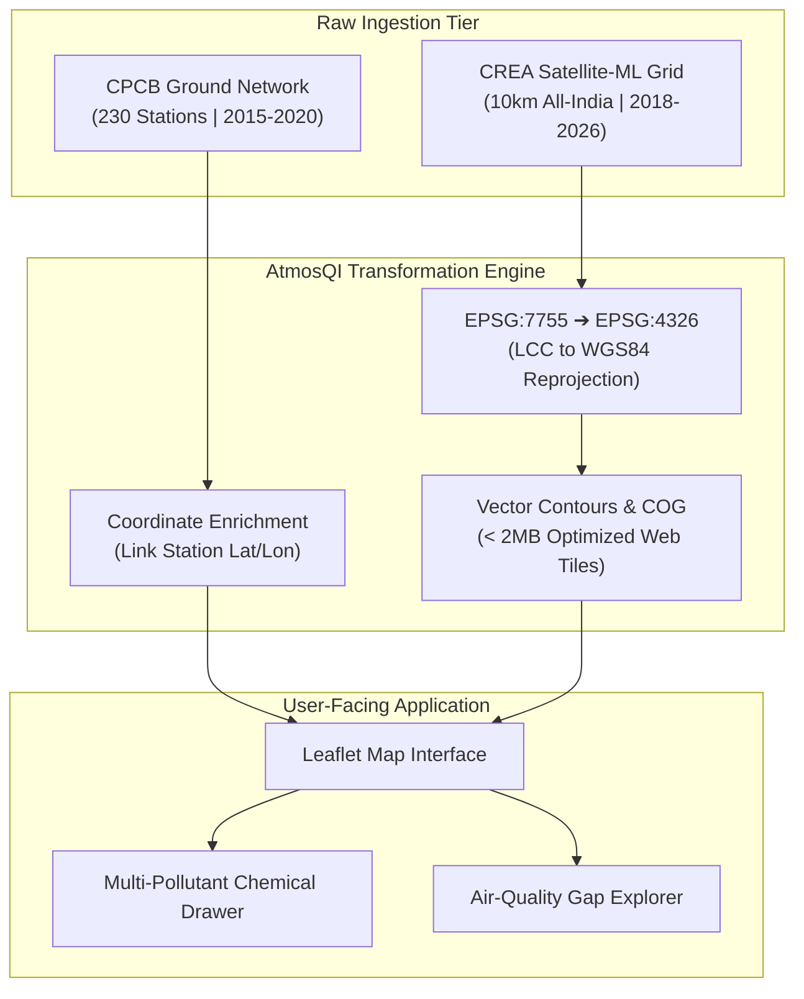
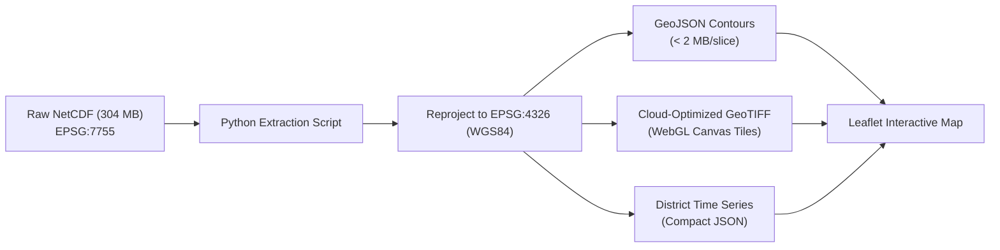

# AtmosQI — Dataset Specification & Data Dictionary

<div align="center">

[](LICENSE)
[](#)
[](#)
[](#)

**Official Data Engineering Specification for the AtmosQI Open-Source Platform**  
*A dual-tier atmospheric observation system for ground truth and high-resolution spatial modeling.*

</div>

---

## Table of Contents

- [1. Architecture Overview](#1-architecture-overview)
- [2. Quick Reference Comparison](#2-quick-reference-comparison)
- [3. Tier 1: Ground Observational Network (CPCB)](#3-tier-1-ground-observational-network-cpcb)
  - [Station Registry (`stations.csv`)](#station-registry-stationscsv)
  - [Daily Observations (`station_day.csv`)](#daily-observations-station_daycsv)
  - [Hourly & City Aggregates](#hourly--city-aggregates)
  - [CPCB AQI Breakpoints Matrix](#cpcb-aqi-breakpoints-matrix)
- [4. Tier 2: Satellite-ML Gridded Surface Raster](#4-tier-2-satellite-ml-gridded-surface-raster)
  - [Dataset Lineage & Provenance](#dataset-lineage--provenance)
  - [Spatial Grid & CRS (`EPSG:7755`)](#spatial-grid--crs-epsg7755)
  - [Internal NetCDF Variables](#internal-netcdf-variables)
- [5. Data Quality & Scientific Integrity](#5-data-quality--scientific-integrity)
- [6. Web Delivery & Transformation Pipeline](#6-web-delivery--transformation-pipeline)
- [7. Citations & Attribution](#7-citations--attribution)

---

## 1. Architecture Overview

AtmosQI operates on a **dual-tier data strategy** to harmonize point-based ground sensors with continuous spatial atmospheric models across India.



---

## 2. Quick Reference Comparison

The table below summarizes the key attributes of both tiers.

| Attribute | Tier 1: Ground Sensors | Tier 2: Satellite-ML Grid |
| :--- | :--- | :--- |
| **Directory / File** | `dataset/AQI-data-past/` | `dataset/pm25-full_rel-...nc` |
| **Measurement Type** | Physical In-situ Monitor | Machine Learning Ensemble |
| **File Format** | CSV (`.csv`) | NetCDF-4 / HDF5 (`.nc`) |
| **Spatial Scope** | 230 Station Points | $33,074$ Valid Land Pixels |
| **Grid Resolution** | Point measurements | $10\text{ km} \times 10\text{ km}$ ($0.1^\circ$) |
| **Time Span** | 2015-01-01 to 2020-07-01 | 2018-08-01 to 2026-05-31 |
| **Parameters** | 12 Chemical Species + AQI | Surface $\text{PM}_{2.5}$ ($\mu\text{g}/\text{m}^3$) |
| **Primary Strength** | Multi-chemical fingerprinting | 100% geographic coverage |
| **Key Limitation** | Urban station clustering | Parameter limited to $\text{PM}_{2.5}$ |

---

## 3. Tier 1: Ground Observational Network (CPCB)

The `dataset/AQI-data-past/` directory provides historical ground truth from continuous ambient monitoring stations.

```text
AQI-data-past/
├── stations.csv       # 230 monitoring stations
├── station_day.csv    # 108,035 daily station records
├── station_hour.csv   # 2.8M hourly records (219 MB)
├── city_day.csv       # 29,531 daily city aggregates
└── city_hour.csv      # Hourly city records (65 MB)
```

---

### Station Registry (`stations.csv`)

Contains operational metadata for 230 monitoring stations across 127 Indian cities and 21 states/UTs.

| Column | Type | Example | Notes |
| :--- | :--- | :--- | :--- |
| `StationId` | `String` | `DL001` | Unique state station code |
| `StationName` | `String` | `Alipur, Delhi - DPCC` | Official station name |
| `City` | `String` | `Delhi` | Administrative city |
| `State` | `String` | `Delhi` | State / Union Territory |
| `Status` | `String` | `Active` | `Active`, `Inactive`, or `NaN` |

> [!NOTE]
> **Spatial Coordinate Matching:**  
> The base `stations.csv` does not include coordinates. AtmosQI links `StationName` against the CPCB Open Data registry to populate `latitude` and `longitude` for map plotting.

---

### Daily Observations (`station_day.csv`)

Contains 108,035 daily records across 110 active reporting stations.

<details open>
<summary><b>View Schema & Parameter Units (Click to collapse)</b></summary>
<br/>

| Parameter | Unit | Normal Range | Averaging Window | Description |
| :--- | :--- | :--- | :--- | :--- |
| `StationId` | — | — | — | Identifier linking to `stations.csv` |
| `Date` | Date | `2015` to `2020` | 24 Hours | Calendar observation date (`YYYY-MM-DD`) |
| `PM2.5` | $\mu\text{g}/\text{m}^3$ | $0 - 1000$ | 24-hr average | Fine inhalable particles ($< 2.5\ \mu\text{m}$) |
| `PM10` | $\mu\text{g}/\text{m}^3$ | $0 - 1500$ | 24-hr average | Inhalable particulate matter ($< 10\ \mu\text{m}$) |
| `NO` | $\mu\text{g}/\text{m}^3$ | $0 - 500$ | 24-hr average | Nitric Oxide |
| `NO2` | $\mu\text{g}/\text{m}^3$ | $0 - 500$ | 24-hr average | Nitrogen Dioxide |
| `NOx` | $\text{ppb}$ | $0 - 500$ | 24-hr average | Oxides of Nitrogen |
| `NH3` | $\mu\text{g}/\text{m}^3$ | $0 - 1000$ | 24-hr average | Ammonia |
| `CO` | $\text{mg}/\text{m}^3$ | $0 - 50$ | 8-hr / 24-hr avg | Carbon Monoxide *(Note: $\text{mg}$, not $\mu\text{g}$)* |
| `SO2` | $\mu\text{g}/\text{m}^3$ | $0 - 500$ | 24-hr average | Sulfur Dioxide |
| `O3` | $\mu\text{g}/\text{m}^3$ | $0 - 500$ | 8-hr max / 24-hr | Ground-level Ozone |
| `Benzene` | $\mu\text{g}/\text{m}^3$ | $0 - 100$ | 24-hr average | Volatile Organic Hydrocarbon (VOC) |
| `Toluene` | $\mu\text{g}/\text{m}^3$ | $0 - 200$ | 24-hr average | Industrial / fuel volatile hydrocarbon |
| `Xylene` | $\mu\text{g}/\text{m}^3$ | $0 - 100$ | 24-hr average | Industrial aromatic solvent |
| `AQI` | Score | $0 - 500+$ | Composite | Official Indian National AQI score |
| `AQI_Bucket` | Category | 6 Levels | Composite | Qualitative health category |

</details>

---

### Hourly & City Aggregates

- **`station_hour.csv` (219 MB):** Identical schema to `station_day.csv`, substituting `Date` with `Datetime` (`YYYY-MM-DD HH:MM:SS`). Ideal for diurnal cycles and peak rush-hour analysis.
- **`city_day.csv` & `city_hour.csv`:** Aggregated city-wide averages across 26 major metropolitan jurisdictions (Delhi, Mumbai, Bengaluru, Patna, Kolkata, etc.).

---

### CPCB AQI Breakpoints Matrix

Under the Indian National Air Quality Index (NAQI), AQI is calculated using non-linear sub-index breakpoints:

$$I = \frac{I_{hi} - I_{lo}}{B_{hi} - B_{lo}} \times (C - B_{lo}) + I_{lo}$$

The overall score follows the **maximum sub-index** rule:

$$\text{AQI} = \max(I_{\text{PM2.5}}, I_{\text{PM10}}, I_{\text{NO2}}, I_{\text{SO2}}, I_{\text{CO}}, I_{\text{O3}}, I_{\text{NH3}})$$

#### Core Particulate & Gas Breakpoints

| Category | AQI Range | PM2.5 ($\mu\text{g}/\text{m}^3$) | PM10 ($\mu\text{g}/\text{m}^3$) | NO2 ($\mu\text{g}/\text{m}^3$) | Hex Color |
| :--- | :---: | :---: | :---: | :---: | :---: |
| **Good** | $0 - 50$ | $0 - 30$ | $0 - 50$ | $0 - 40$ | `#009966` |
| **Satisfactory** | $51 - 100$ | $31 - 60$ | $51 - 100$ | $41 - 80$ | `#8DC443` |
| **Moderate** | $101 - 200$ | $61 - 90$ | $101 - 250$ | $81 - 180$ | `#FFDE33` |
| **Poor** | $201 - 300$ | $91 - 120$ | $251 - 350$ | $181 - 280$ | `#FF9933` |
| **Very Poor** | $301 - 400$ | $121 - 250$ | $351 - 430$ | $281 - 400$ | `#CC0033` |
| **Severe** | $401 - 500+$ | $250+$ | $430+$ | $400+$ | `#7E0023` |

<details>
<summary><b>View Secondary Gas Breakpoints (CO, SO2, O3, NH3)</b></summary>
<br/>

| Category | CO ($\text{mg}/\text{m}^3$) | SO2 ($\mu\text{g}/\text{m}^3$) | O3 ($\mu\text{g}/\text{m}^3$) | NH3 ($\mu\text{g}/\text{m}^3$) |
| :--- | :---: | :---: | :---: | :---: |
| **Good** | $0 - 1.0$ | $0 - 40$ | $0 - 50$ | $0 - 200$ |
| **Satisfactory** | $1.1 - 2.0$ | $41 - 80$ | $51 - 100$ | $201 - 400$ |
| **Moderate** | $2.1 - 10.0$ | $81 - 380$ | $101 - 168$ | $401 - 800$ |
| **Poor** | $10.1 - 17.0$ | $381 - 800$ | $169 - 208$ | $801 - 1200$ |
| **Very Poor** | $17.1 - 34.0$ | $801 - 1600$ | $209 - 748$ | $1201 - 1800$ |
| **Severe** | $> 34.0$ | $> 1600$ | $> 748$ | $> 1800$ |

</details>

---

## 4. Tier 2: Satellite-ML Gridded Surface Raster

### Dataset Lineage & Provenance

- **Target File:** `pm25-full_rel-2026-07-r0_s-1.0_mb-1.3-r0(1).nc` (304.16 MB)
- **Container Format:** NetCDF-4 (CF-1.8 Compliant, HDF5 backend)
- **Origin & Authors:** Centre for Research on Energy and Clean Air (CREA) / Kawano et al. (Zenodo / *Science Advances*)
- **Model Framework:** Two-stage machine learning ensemble integrating Sentinel-5P TROPOMI satellite tropospheric columns, MODIS MAIAC Aerosol Optical Depth (AOD), ERA5 reanalysis meteorology, and ground CAAQMS calibration.

---

### Spatial Grid & CRS (`EPSG:7755`)

The dataset is projected in the **WGS 84 / India NSF Lambert Conformal Conic** coordinate system to eliminate spatial distortion across the subcontinent:

| Parameter | Specification | Details |
| :--- | :--- | :--- |
| **Projection Authority** | `EPSG:7755` | Survey of India Lambert Conformal Conic |
| **Standard Parallels** | $12.472955^\circ\text{N}$, $35.172804^\circ\text{N}$ | Optimized for Indian latitude range |
| **Central Meridian / False Origin** | $80.0^\circ\text{E}$ / $24.0^\circ\text{N}$ | Centered on mainland India |
| **Grid Resolution** | $10,000\text{ m} \times 10,000\text{ m}$ | $10\text{ km}$ uniform square cells |
| **Raster Dimensions** | $328 \times 287$ ($94,136$ cells) | $328$ Northing cells ($Y$), $287$ Easting cells ($X$) |
| **Active Land Pixels** | **$33,074$ cells** ($35.13\%$) | Oceanic & trans-border zones masked as `NaN` |
| **Geographic Bounds** | Lat: $3.87^\circ\text{N} - 35.51^\circ\text{N}$ | Lon: $65.60^\circ\text{E} - 97.42^\circ\text{E}$ |

---

### Internal NetCDF Variables

```text
NetCDF4 Hierarchy:
├── pm25         (time: 2861, y: 328, x: 287)  -> float32 [µg/m³]
├── time         (time: 2861)                  -> int64 [days since 2000-01-01]
├── y            (y: 328)                      -> float32 [Northing in meters]
├── x            (x: 287)                      -> float32 [Easting in meters]
└── spatial_ref  ()                            -> CRS WKT Definition
```

- **Temporal Coverage:** 2,861 unbroken daily time slices.
  - **Start Date:** August 1, 2018 (`2018-08-01`, $t_0 = 6,787$)
  - **End Date:** May 31, 2026 (`2026-05-31`, $t_{2860} = 9,647$)
- **Values:** Valid surface $\text{PM}_{2.5}$ range from $\approx 0.1\ \mu\text{g}/\text{m}^3$ to $> 500\ \mu\text{g}/\text{m}^3$ during winter inversion episodes.

---

## 5. Data Quality & Scientific Integrity

AtmosQI maintains strict scientific integrity rules to ensure data reliability:

> [!CAUTION]
> **Prohibition of Pseudo-AQI Averaging:**  
> Never calculate an overall AQI by taking the arithmetic mean of pollutant concentrations across columns (`avg(PM2.5, NO2, SO2)`). Official AQI is strictly governed by the piecewise maximum sub-index formula.

> [!IMPORTANT]
> **Missing Values Policy:**  
> Missing measurements (`NaN`, blanks) represent offline stations, telemetry dropouts, or maintenance intervals. They must **never** be imputed as zero (`0.0`). Zero-filling falsely suggests pristine air.

> [!TIP]
> **Clear Provenance Badging:**  
> Every displayed metric must carry a visible origin tag:
> - `Physical Sensor (Ground Truth)`: In-situ CPCB/SPCB station.
> - `Satellite-ML Model (Continuous)`: 10km gridded raster estimate.

---

## 6. Web Delivery & Transformation Pipeline

A 304 MB NetCDF file cannot be loaded directly in browser JavaScript. The pipeline below optimizes the dataset for instant web delivery:



1. **Reprojection (`EPSG:7755` $\to$ `EPSG:4326`):** Project Easting/Northing meters into Geographic Latitude/Longitude coordinates.
2. **Contour Vectorization:** Convert continuous rasters into lightweight GeoJSON polygons classified by the 6 standard AQI colors.
3. **Station Indexing:** Pre-index station time series into compressed JSON for instant client-side lookup upon clicking any marker.

---

## 7. Citations & Attribution

1. **Central Pollution Control Board (CPCB), MoEFCC, India:**  
   *National Air Quality Index: Monitoring & Calculation Methodologies.* [cpcb.nic.in](https://cpcb.nic.in/)
2. **Centre for Research on Energy and Clean Air (CREA) / Kawano et al. (2025/2026):**  
   *High-Quality Daily $\text{PM}_{2.5}$ Datasets for India at 10 km Resolution (Version 2).* Hosted on Zenodo. DOI: [10.5281/zenodo.10073944](https://doi.org/10.5281/zenodo.10073944)
3. **Open Government Data (OGD) Platform India:**  
   *National Air Quality Index Catalog & Datasets.* [data.gov.in](https://data.gov.in/)
4. **XKDR Forum:**  
   *India Air Quality Database & Station Locations.* [airquality.xkdr.org](https://airquality.xkdr.org/)
