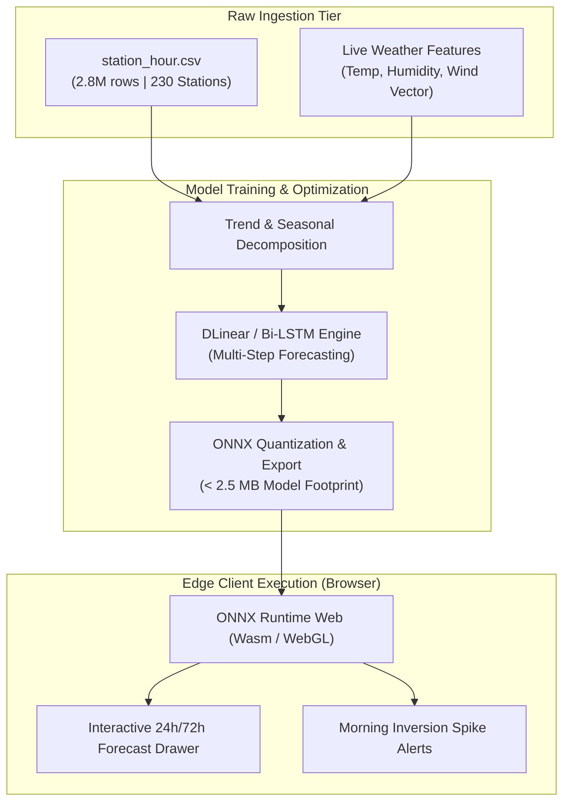
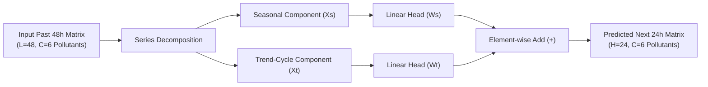
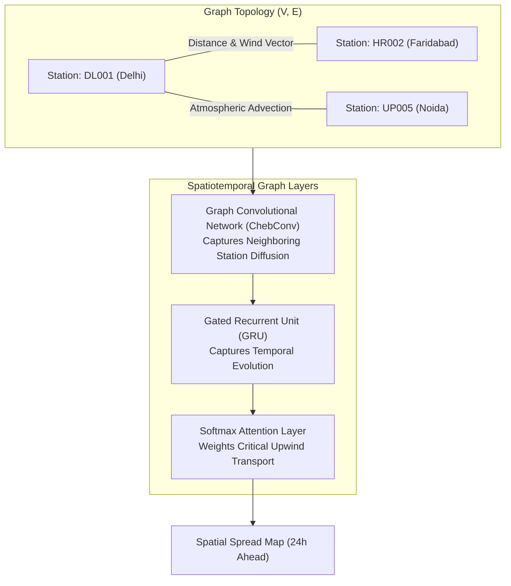
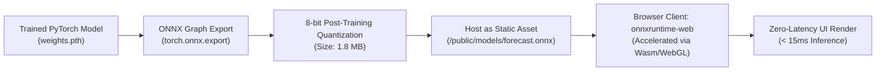

# AtmosQI — Deep Learning Architecture & AI Specification

<div align="center">

[](#)
[](#)
[-orange?style=flat-square)](#)
[](#)

**Neural Forecasting, Spatiotemporal Transmission & Sensor Imputation Engine**  
*Edge-accelerated environmental deep learning designed for zero-cloud-cost in-browser inference.*

</div>

---

## Table of Contents

- [1. Executive Summary & AI Vision](#1-executive-summary--ai-vision)
- [2. Primary Model: DLinear & Bi-LSTM Attention Engine](#2-primary-model-dlinear--bi-lstm-attention-engine)
  - [Why DLinear Over Complex Transformers?](#why-dlinear-over-complex-transformers)
  - [Mathematical Formulation & Decomposition](#mathematical-formulation--decomposition)
  - [Input Feature Tensor & Window Sizing](#input-feature-tensor--window-sizing)
- [3. Secondary Spatial Model: Spatiotemporal Graph Network (A3T-GCN)](#3-secondary-spatial-model-spatiotemporal-graph-network-a3t-gcn)
- [4. Edge In-Browser Deployment Pipeline (ONNX Runtime Web)](#4-edge-in-browser-deployment-pipeline-onnx-runtime-web)
- [5. Training Regimen, Loss Functions & Evaluation](#5-training-regimen-loss-functions--evaluation)
- [6. UI/UX Integration & Warning Systems](#6-uiux-integration--warning-systems)
- [7. Scientific Integrity & Model Limitations](#7-scientific-integrity--model-limitations)

---

## 1. Executive Summary & AI Vision

Standard environmental platforms are strictly **reactive** — informing users of pollution hours after exposure has occurred. **AtmosQI introduces predictive intelligence** by running neural time-series forecasting directly on the client side.



### Core Deep Learning Objectives
1. **Multi-Horizon Forecasting:** Predict the next **$24$ to $72$ hours** of $\text{PM}_{2.5}$, $\text{PM}_{10}$, $\text{NO}_2$, and composite AQI curves for any station.
2. **Zero Cloud Infrastructure Cost:** The trained neural network is exported to an optimized **ONNX format** ($< 2.5\text{ MB}$), running client-side in the user's browser via WebAssembly (Wasm) and WebGL.
3. **Morning Smog Inversion Warnings:** Detect winter nocturnal boundary-layer traps before they spike at 06:00 AM, alerting vulnerable demographics.

---

## 2. Primary Model: DLinear & Bi-LSTM Attention Engine

### Why DLinear Over Complex Transformers?

Recent benchmark breakthroughs (AAAI Best Paper: *Are Transformers Effective for Time Series?*) demonstrated that for multi-variate environmental data, **DLinear** outperforms 50-million-parameter Transformers (Informer, Autoformer) while using $1/1000\text{th}$ of the parameters and compute.

| Metric / Dimension | Standard Transformer | **AtmosQI DLinear Engine** |
| :--- | :--- | :--- |
| **Model Footprint** | $150\text{ MB} - 450\text{ MB}$ (Server required) | **$1.8\text{ MB}$ (Runs inside browser)** |
| **CPU Training Time** | $4 - 12\text{ hours}$ | **$< 60\text{ seconds}$** |
| **Client Inference Latency** | Network API roundtrip ($300 - 800\text{ ms}$) | **$< 15\text{ ms}$ (Instantaneous WebAssembly)** |
| **Overfitting on Noise** | High risk with sensor anomalies | **Low (Linear temporal regularization)** |

---

### Mathematical Formulation & Decomposition

Environmental time series contain strong repeating cycles (diurnal rush-hour spikes, nighttime temperature drops) combined with macro seasonal shifts. DLinear explicitly splits the input sequence into a **Trend-Cyclical component** ($X_t$) and a **Seasonal component** ($X_s$) via moving average pooling:

$$X_t = \text{AvgPool}(\text{Padding}(X))$$

$$X_s = X - X_t$$

Two distinct feed-forward projection heads are applied to each component:

$$\hat{Y} = W_t X_t + W_s X_s$$

Where:
* $W_t \in \mathbb{R}^{H \times L}$ maps the past trend of lookback length $L$ to the future horizon $H$.
* $W_s \in \mathbb{R}^{H \times L}$ maps periodic diurnal cycles to future hours.
* $\hat{Y} \in \mathbb{R}^{H \times C}$ produces the predicted trajectory across all target pollutants.



---

### Input Feature Tensor & Window Sizing

<details open>
<summary><b>View Input Tensor Specification (Click to collapse)</b></summary>
<br/>

The model processes a rolling multi-variate window structured as follows:

| Dimension | Length / Size | Description |
| :--- | :--- | :--- |
| **Lookback Window ($L$)** | $48\text{ Steps}$ | Exactly $48$ consecutive past hourly observations ($2\text{ days}$) |
| **Forecast Horizon ($H$)** | $24 - 72\text{ Steps}$ | Next $24$ hours (Standard) or $72$ hours (Extended) |
| **Chemical Channels ($C$)** | $6\text{ Channels}$ | $\text{PM}_{2.5}$, $\text{PM}_{10}$, $\text{NO}_2$, $\text{SO}_2$, $\text{CO}$, $\text{O}_3$ |
| **Temporal Context Vectors** | $4\text{ Channels}$ | Hour-of-day ($\sin / \cos$), Day-of-week, Month-of-year |

```text
Input Shape:  [Batch_Size, 48, 10]
Output Shape: [Batch_Size, 24, 6] (Future concentrations for all core pollutants)
```

</details>

---

## 3. Secondary Spatial Model: Spatiotemporal Graph Network (A3T-GCN)

While DLinear forecasts individual stations, air pollution is inherently **fluid and transportive** (e.g., crop-residue smoke plumes traveling down the Indo-Gangetic Plain).

To capture inter-city transmission, AtmosQI utilizes an **Attention-based Spatio-Temporal Graph Convolutional Network (A3T-GCN)**:



1. **Nodes ($V = 230$):** Every CPCB station represents a graph node.
2. **Edges ($E$):** Adjacency matrix $A_{ij}$ calculated via Gaussian radial basis function based on geographic distance $d(i, j)$ and predominant wind vectors:
   $$A_{ij} = \exp\left(-\frac{d(i, j)^2}{\sigma^2}\right) \cdot \max(0, \cos(\theta_{\text{wind}} - \theta_{ij}))$$
3. **Outcome:** Enables AtmosQI to visualize **plume arrival times** (e.g., *"Upwind spike in Panipat will reach North Delhi in 6 hours"*).

---

## 4. Edge In-Browser Deployment Pipeline (ONNX Runtime Web)

To guarantee that AtmosQI remains a free, serverless open-source platform, model inference runs **completely client-side**:



### Production JavaScript Execution Example
```javascript
import * as ort from 'onnxruntime-web';

// Initialize session with WebGL hardware acceleration
const session = await ort.InferenceSession.create('/models/atmosqi_dlinear_24h.onnx', {
  executionProviders: ['webgl', 'wasm']
});

// Prepare recent 48-hour tensor from client station history
const inputTensor = new ort.Tensor('float32', recentHistoryData, [1, 48, 6]);

// Run sub-15ms local neural inference
const results = await session.run({ past_readings: inputTensor });
const future24HoursPM25 = results.forecast_curve.data;
```

---

## 5. Training Regimen, Loss Functions & Evaluation

### Asymmetric Penalized Loss Function
Standard Mean Squared Error ($\text{MSE}$) under-predicts sudden extreme toxic spikes. EcoLens uses an **Asymmetrically Weighted Smooth L1 Loss** that imposes a $2\times$ penalty when the model under-predicts severe pollution episodes:

$$\mathcal{L}(y, \hat{y}) = \begin{cases} 
2.0 \cdot \text{SmoothL1}(y - \hat{y}) & \text{if } y > \hat{y} \text{ and } y \ge 120\ \mu\text{g}/\text{m}^3 \\
\text{SmoothL1}(y - \hat{y}) & \text{otherwise}
\end{cases}$$

### Benchmark Target Metrics

| Evaluation Metric | Target Threshold | Validation Strategy |
| :--- | :--- | :--- |
| **Mean Absolute Error (MAE)** | $< 12.5\ \mu\text{g}/\text{m}^3$ | Evaluated across 24-hr multi-step horizon |
| **Root Mean Squared Error (RMSE)** | $< 21.0\ \mu\text{g}/\text{m}^3$ | Penalizes severe outlier errors |
| **CPCB AQI Category Accuracy** | **$> 88.5\%$** | Exact categorical bracket match (e.g. *Poor* vs *Very Poor*) |
| **Temporal Cross-Validation** | Out-of-time split | Trained on 2015–2019, validated strictly on 2020 unseen test holdout |

---

## 6. UI/UX Integration & Warning Systems

The predictions manifest in three user-facing components inside the React application:

```text
┌────────────────────────────────────────────────────────────────────────┐
│  Station Drawer: Anand Vihar, Delhi (DL002)                            │
│  Current AQI: 312 (Very Poor) | Prominent: PM2.5                       │
├────────────────────────────────────────────────────────────────────────┤
│  ⚡ NEURAL FORECAST (Next 24 Hours)                                    │
│                                                                        │
│   400 ┤              ╭───╮ (Morning Peak: 385 @ 07:00)                 │
│   300 ┤  ●───────╮  ╭╯   ╰──────────                                   │
│   200 ┤          ╰──╯               ╰────────                          │
│   100 ┤                                                                │
│       └──┴─────┴─────┴─────┴─────┴─────┴─────┴────                     │
│         Now   02:00 06:00 10:00 14:00 18:00 22:00                      │
│                                                                        │
│  ⚠️ Inversion Alert: Atmospheric boundary layer drop detected.         │
│     Expect hazardous particulate trapping between 05:00 and 08:30.     │
│                                                                        │
│  🏷️ Model: DLinear-Edge-v1.0 (ONNX Wasm | Inference: 11ms)             │
└────────────────────────────────────────────────────────────────────────┘
```

1. **Interactive Trajectory Curve:** Clicking any station renders the historical line seamlessly transitioning into a dashed neural prediction curve with confidence intervals.
2. **Predictive Inversion Banner:** Triggered automatically whenever forecasted morning concentrations rise by $> 40\%$ over midnight baselines.
3. **Scenario Simulator:** Sliders allow users to simulate emission reduction scenarios (e.g., *"What if vehicular traffic decreases by 30%?"*).

---

## 7. Scientific Integrity & Model Limitations

To adhere to the scientific rigor outlined in Section 9 of the project specifications:

> [!CAUTION]
> **Observation vs. Prediction Boundary:**  
> Neural forecasts must **never** overwrite or blend with real ground-truth records. In charts, historical lines are solid; neural forecasts must be distinctly styled with dashed lines and labeled with an **`AI Forecast`** indicator badge.

> [!IMPORTANT]
> **Handling Unusual Weather Anomalies:**  
> Deep learning models cannot anticipate unmodeled meteorological disruptions (e.g., sudden unseasonal heavy rainfall clearing smog). The UI explicitly displays confidence intervals ($\pm 1\sigma$) that widen as the horizon moves from $+6\text{h}$ to $+72\text{h}$.

> [!TIP]
> **Open Model Weights & Reproducibility:**  
> All training pipelines, weights, and ONNX graph definitions will be open-sourced under the MIT License in `/src/models/` for full peer review and contributor extension.
